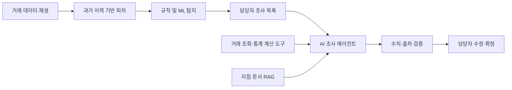

<div align="center">

<h1>FinGuard</h1>
<p><strong>이상거래를 찾고, 근거를 확인하고, AI 조사 보고서를 검증합니다.</strong></p>
<p>카드 거래 탐지부터 담당자 검토까지 연결하는 금융 AI 프로젝트</p>
<p>
  
  
  
</p>
<p>
  <a href="#overview">소개</a> · <a href="#features">목표 기능</a> ·
  <a href="#getting-started">시작하기</a> · <a href="#evaluation">평가</a> ·
  <a href="#roadmap">로드맵</a> · <a href="docs/DEVELOPMENT_ISSUES.md">개발 이슈 초안</a>
</p>
</div>

> **현재 상태: 로컬 기획·개발 준비 단계.** GitHub 생성·게시 전입니다. 실행 코드·학습 모델·배포 서비스는 없으며 아래 기능과 기술은 구현 계획입니다. 결과는 실제 측정 후 공개합니다.

<a id="overview"></a>

## 해결하려는 문제

의심 거래를 찾은 뒤에도 담당자는 고객의 과거 거래를 확인하고, 탐지 사유를 해석하고, 업무 지침을 찾아 조사 내용을 정리해야 합니다. FinGuard는 탐지부터 근거 조회와 보고서 검토까지 하나의 흐름으로 연결합니다.

검증할 질문은 다음과 같습니다.

1. **같은 조사 가능 건수에서** 규칙 기반 방식보다 실제 사기 거래를 더 많이 찾는가?
2. **수치와 출처를 검증하는 AI 보조 조사**가 보고서의 정확성과 작성 시간에 어떤 영향을 주는가?
3. 재시도·동시 요청·AI 장애 상황에서도 거래 기록과 조사 과정이 추적 가능한가?

## 사용 흐름



LLM은 조사 근거를 모아 보고서 초안을 작성합니다. 거래 점수는 모델과 정책 코드가 계산하며, 사건의 최종 판정은 담당자가 기록합니다. 에이전트의 도구에는 실제 송금·차단·계정 변경을 포함하지 않습니다.

<a id="features"></a>

## 구현할 기능

| 영역 | 구현 계획 | 관련 작업 |
|---|---|---|
| 데이터·피처 | 출처·라벨 확인, 시간순 재생, 과거 이력과 학습·추론 계산 일치 | [FG-02~05](docs/DEVELOPMENT_ISSUES.md#fg-02) |
| 탐지·행동 분석 | 규칙·로지스틱 회귀·트리 모델 비교, 군집·이상 점수 제거 실험 | [FG-06~08](docs/DEVELOPMENT_ISSUES.md#fg-06) |
| 거래·조사 화면 | 거래 API, 고객 상태·사건·담당자 검토 이력 | [FG-09~10](docs/DEVELOPMENT_ISSUES.md#fg-09) |
| 문서·검색 | 지침 수집·파싱·청킹, 키워드·벡터·하이브리드 비교 | [FG-11~12](docs/DEVELOPMENT_ISSUES.md#fg-11) |
| 보고서·에이전트 | 도구 호출, 수치·출처 검증, 호출 제한과 근거 추적 | [FG-13~14](docs/DEVELOPMENT_ISSUES.md#fg-13) |
| 평가·운영 | 통합 평가, 테스트·CI, 접근 권한, 장애·복구, 실패 개선 | [FG-15~19](docs/DEVELOPMENT_ISSUES.md#fg-15) |
| 선택 확장 | 연합학습, 계좌 관계·AML, 성능 최적화, 참고 뉴스 | [FG-21~24](docs/DEVELOPMENT_ISSUES.md#fg-21)
## 설계의 핵심

- **거래 단위 예측:** 학습과 API의 예측 대상을 현재 거래의 `is_fraud`로 통일합니다.
- **시간 누수 방지:** 고객 이력 피처는 해당 거래 이전 정보로 계산합니다. 학습·검증·평가는 시간순으로 분리합니다.
- **학습·추론 일치:** 피처 정의와 계산을 공유하고 동일한 거래열의 오프라인·온라인 결과를 비교합니다.
- **거래 정합성:** 거래 ID 중복 방지와 고객별 원자적 상태 갱신, DB·Redis 장애 복구를 설계합니다.
- **독립된 처리 경로:** 거래 점수 API에서 LLM을 호출하지 않습니다. 보고서는 별도 작업으로 생성합니다.
- **제한된 도구 권한:** 사건 접근 권한은 서버가 확인하고, 문서 속 지시문은 조회 자료로 처리합니다.
- **추적 가능한 보고서:** 관측 사실·모델 설명·문서 근거를 구분하고 데이터·모델·프롬프트·문서 버전을 남깁니다.

## 계획한 기술

| 용도 | 후보 기술 |
|---|---|
| 데이터·ML | Python, Pandas, NumPy, scikit-learn, XGBoost |
| API·저장소 | FastAPI, PostgreSQL, Redis |
| 검색·에이전트 | Chroma, LangChain, LangGraph |
| 시제품 UI·실행 | Gradio, Docker Compose |

후보 모델은 같은 조건에서 비교하고 결과에 따라 선택합니다. 모든 후보를 운영 경로에 넣지는 않습니다. 실제 패키지 버전과 실행 명령은 구현 후 기록합니다.

<a id="getting-started"></a>

```powershell
pwsh -File ./tools/prepare_repository.ps1
```

<details>
<summary>현재 구성</summary>

```text
finguard/
├── README.md
├── .gitignore
├── .github/
│   ├── ISSUE_TEMPLATE/          # 개발·버그·기능·유지보수·실험 양식
│   ├── pull_request_template.md
│   └── labels.json
├── docs/
│   ├── PROJECT_PLAN.md
│   ├── DEVELOPMENT_ISSUES.md
│   ├── WORKFLOW.md
│   └── issue-seed.json
└── tools/
    └── prepare_repository.ps1   # 로컬 초안 생성
```

API·ML·검색·화면·평가 코드는 구현할 때 추가합니다.

</details>

## 사용 시나리오

| 요청·상황 | 기대하는 동작 |
|---|---|
| “이 거래가 이전 소비와 어떻게 다른지 설명해줘.” | 해당 시점 이전 거래 통계를 도구로 계산하고 근거 거래를 연결 |
| “추가 확인할 내용을 지침과 함께 정리해줘.” | 문서·버전·페이지를 찾아 모의 업무 지침 여부를 표시 |
| 보고서에 조회 결과와 다른 금액이 들어감 | 검증 실패로 표시하고 보완 후 담당자 검토 |
| 다른 담당자의 사건을 요청하거나 문서가 도구 오용을 지시함 | 서버 권한과 도구 제한으로 접근·실행 차단 |
| 거래가 중복 전송되거나 LLM이 응답하지 않음 | 거래 중복 반영 방지, 보고서 실패 상태 표시, 점수 API 유지 |

<a id="evaluation"></a>

## 평가 계획

- **탐지:** AP, 혼동행렬, Precision/Recall, 일일 조사 예산 B건의 Precision@B·Recall@B, 신규 고객별 성능.
- **보고서:** 검색·인용 정확성, 도구 결과와 수치 일치, 근거 부족 시 답변 유보, 조사 시간과 정확도.
- **서비스:** 점수 API 지연·처리량, 중복·동시 요청, Redis·LLM 장애 처리.
- **에이전트:** 비인가 사건 조회, 문서 내 악성 지시, 가짜 출처, 개인정보 전송, 무한 도구 호출 방지.

평가 환경·기간·표본 수·실험 설정과 함께 결과를 공개합니다. 기획 목표를 달성한 성과로 표시하지 않습니다.

<a id="roadmap"></a>

## 개발 로드맵

| 계획 시점 | 목표 | 작업 |
|---|---|---|
| 1~2주 | 구조·데이터·재생·시점별 피처·평가 분할 | [FG-01~05](docs/DEVELOPMENT_ISSUES.md#fg-01) |
| 2~3주 | 기준선·후보 모델·행동 정보의 추가 효과 | [FG-06~08](docs/DEVELOPMENT_ISSUES.md#fg-06) |
| 4주 | 거래 정합성·조사 화면 | [FG-09~10](docs/DEVELOPMENT_ISSUES.md#fg-09) |
| 5주 | 출처 보존·검색 비교 | [FG-11~12](docs/DEVELOPMENT_ISSUES.md#fg-11) |
| 6주 | 검증 가능한 보고서·조사 에이전트 | [FG-13~14](docs/DEVELOPMENT_ISSUES.md#fg-13) |
| 6~8주 | 통합 평가·테스트·보안·운영·실패 개선 | [FG-15~19](docs/DEVELOPMENT_ISSUES.md#fg-15) |
| 8주 | 시연·결과·포트폴리오 | [FG-20](docs/DEVELOPMENT_ISSUES.md#fg-20) |
| 핵심 평가 이후 | 조건 충족 시 선택 확장 | [FG-21~24](docs/DEVELOPMENT_ISSUES.md#fg-21) |

핵심·완성 작업 20개와 선택 확장 4개입니다. 상세 작업에는 **목적·할 일·완료 조건·산출물·선행 작업·작업 결과**를 기록합니다. 실제 순서는 [각 작업의 선행 조건](docs/DEVELOPMENT_ISSUES.md)을 따릅니다.

## 데이터와 확장 범위

첫 버전은 교육 저장소의 카드 거래 데이터 구조를 출발점으로 합니다. 원 데이터의 출처·생성 방식·이용 및 재배포 조건을 먼저 확인하고, 원본 데이터·개인정보·모델 파일·API 키는 저장소에 포함하지 않습니다. 합성 시연 데이터와 모델 성능 평가 데이터를 구분합니다.

보이스피싱·AML은 계좌 간 송금 관계와 해당 라벨을 확보한 뒤 별도 평가로 확장합니다. 연합학습, 금융 뉴스, 디지털 결제 거래는 후속 후보입니다.

## 학습 기반과 기획 배경

하나 청년 금융인재 양성 프로젝트의 [교육 저장소](https://github.com/BBungya/hana_power_on)에서 학습한 데이터 분석·FDS·RAG·에이전트 개념을 하나의 서비스로 발전시키는 프로젝트입니다. 교육 저장소의 공식 후속 서비스나 금융기관과의 제휴 프로젝트를 뜻하지 않습니다. 교육 코드 재사용 전 라이선스와 이용 범위를 확인합니다.

금융 업무 에이전트, 금융사기 대응, AI 안전성·신뢰성 평가라는 최근 흐름과의 연결 근거는 [기획서의 동향 분석](docs/PROJECT_PLAN.md#11-최근-금융-itai-흐름과-프로젝트의-연결)에 정리했습니다.
