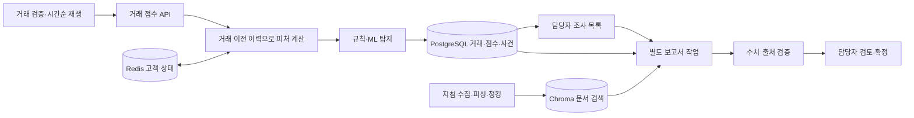

# FinGuard 개발 구조

## 현재 저장소 구성

| 경로 | 역할 |
| --- | --- |
| `pyproject.toml`, `.python-version`, `uv.lock` | Python 버전, 프로젝트 메타데이터, 개발 의존성과 잠금 정보 |
| `.env.example`, `.gitignore` | 환경변수 예시와 로컬 파일 제외 규칙 |
| `README.md`, `docs/` | 개발 환경 설치, 프로젝트 기획, 아키텍처, 이슈와 작업 규칙 |
| `.github/`, `tools/` | GitHub 템플릿·라벨 정의와 운영 문서 생성 스크립트 |
| `src/finguard/`, `tests/` | 거래 검증·로컬 재생, [카드 이력 피처](history_features.md), 재현성 테스트 |

## 구현할 디렉터리

| 경로 | 역할 |
| --- | --- |
| `src/finguard/` | 탐지, API, 검색과 보고서 생성 코드 |
| `configs/` | 버전 관리가 필요한 피처·탐지 정책·실험 설정 |
| `evals/` | 탐지·검색·보고서 평가 입력과 실행기 |
| `reports/` | 공유 가능한 평가 요약과 실험 분석 문서 |

## 구현 흐름

학습과 추론은 피처 계산을 공유하며, 거래 시점 이전 이력만 사용한다. PostgreSQL이 거래와 사건의 원본 기록을 보관하고 Redis의 고객 상태는 필요할 때 재구성한다. 보고서 생성은 거래 점수 요청과 분리해 별도 작업으로 실행한다. 상세 흐름은 [프로젝트 기획서](PROJECT_PLAN.md#6-구현-구조)를 참고한다.

## 개발 환경 결정

- Python은 3.12 계열로 통일한다. 지원 범위는 `pyproject.toml`, 로컬에서 선택할 버전은 `.python-version`에 기록한다. 한 계열을 기준으로 후속 데이터·ML 라이브러리의 호환성을 점검한다.
- `uv`로 가상환경과 잠금 파일을 관리한다. 개발 도구는 `dev` 그룹에 두고, 기능에서 import하는 런타임 의존성은 해당 구현 PR에서 추가한다. 의존성을 바꿀 때 `pyproject.toml`과 `uv.lock`을 함께 커밋한다. [uv 잠금 및 동기화 문서](https://docs.astral.sh/uv/concepts/projects/sync/)
- `.env.example`의 변수는 해당 기능을 연결할 때 채운다. 접속 정보와 키는 Git에서 제외되는 로컬 `.env` 또는 배포 환경의 비밀 저장소에 보관한다.

프로젝트 구조나 런타임 선택이 바뀌면 이 문서에 결정과 이유를 남기고, 관련 이슈와 PR을 연결한다. 브랜치 이름과 PR 기록 방식은 [작업 규칙](WORKFLOW.md)을 따른다.
