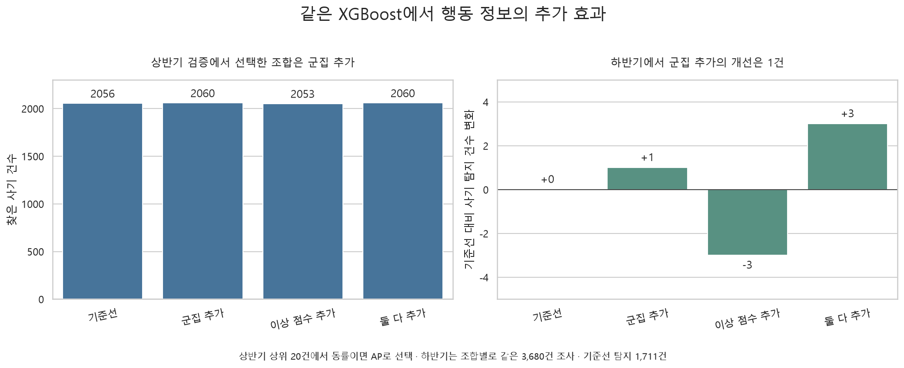

# 군집·이상 점수 추가 전후 비교

이슈 #8의 세 번째·네 번째 단계로, #7에서 선택한 카드 이력 기반 XGBoost에 행동 정보를 추가했습니다. 모델은 깊이 7, 트리 100개, 학습률 0.1과 시드 42를 고정했습니다. [비교 설정](../configs/behavior_ablation.toml)

## 실험 방법

| 조합 | 입력 |
| --- | --- |
| 기준선 | 현재 금액·시간대·업종 + 직전 카드 이력 |
| 군집 추가 | 기준선 + KMeans 그룹별 해당 여부 |
| 이상 점수 추가 | 기준선 + Isolation Forest 점수 |
| 둘 다 추가 | 기준선 + 군집 + 이상 점수 |

전처리기, 스케일러, KMeans와 Isolation Forest는 2019년에서만 학습했습니다. 세 군집은 앞 단계의 학습 표본 실루엣 비교 결과를 사용합니다. KMeans는 시드 42와 초기화 10회, Isolation Forest는 시드 42·트리 100개·트리당 표본 256개로 고정했습니다. 사기 라벨은 XGBoost 학습과 성능 평가에 사용합니다.

군집은 그룹 0·1·2와 이력 없음의 네 열로 표현했습니다. 해당 그룹의 열은 1이고 나머지는 0입니다. 이상 점수는 부호를 바꿔 클수록 드물게 하며, 이력이 없으면 -1로 표시합니다. 카드 이력의 순서·기간 경계는 기존 계산을 따릅니다.

상반기 검증에서 하루 20건으로 찾은 사기가 가장 많은 조합을 선택했습니다. 동률이면 AP를 비교합니다. 선택 후 하반기에서 네 조합을 같은 조사 한도로 대조합니다. 같은 거래의 군집·시간대·금액대·학습 시 카드 등장 여부로 오탐과 미탐을 집계하고, 카드별로 기준선보다 찾은 사기가 늘거나 줄었는지도 확인합니다.

## 결과와 채택

| 조합 | 검증에서 찾은 사기 | 검증 AP | 하반기에서 찾은 사기 | 하반기 정밀도@20 | 하반기 재현율@20 | 하반기 AP |
| --- | ---: | ---: | ---: | ---: | ---: | ---: |
| 기준선 | 2,056 | 0.942903 | 1,711 | 46.49% | 85.04% | 0.895036 |
| **군집 추가** | **2,060** | **0.943828** | **1,712** | **46.52%** | **85.09%** | **0.895564** |
| 이상 점수 추가 | 2,053 | 0.940759 | 1,708 | 46.41% | 84.89% | 0.893719 |
| 둘 다 추가 | 2,060 | 0.943196 | 1,714 | 46.58% | 85.19% | 0.896110 |

검증에서 군집 추가와 둘 다 추가가 같은 2,060건을 찾았습니다. 미리 정한 AP 비교 기준에서 군집 추가가 높아 이를 선택했습니다. 이상 점수 단독은 검증에서 기준선보다 3건을 덜 찾아 이번 조합에서 제외했습니다. 하반기에 둘 다 추가가 가장 많이 찾았지만 후보 선택은 상반기 검증으로 마쳤습니다.

하반기 군집 추가의 개선은 **사기 1건**으로 작았습니다. 이번 실험의 후보로 군집 추가를 채택하고, 뚜렷한 성능 향상 여부는 다른 기간·시드·데이터로 추가 검증할 사항으로 남깁니다. 하반기는 앞선 기준선에서 이미 사용한 합성 테스트 구간입니다.

검증 비용으로 고른 고정 점수 기준에서는 군집 추가의 기준이 0.08818158507347107이었습니다. 이 기준으로 하반기 2,862건을 조사해 사기 1,806건을 찾았고 정밀도는 63.10%였습니다. 기존 모델은 3,042건을 조사해 사기 1,822건, 정밀도 59.89%였습니다. 고정 점수 비교에서는 조사 건수도 달라집니다.



왼쪽은 상반기 사기 탐지 건수이며 세로축은 0부터 시작합니다. 오른쪽은 하반기의 기존 모델 대비 변화로, 군집 추가 +1건, 이상 점수 추가 -3건, 둘 다 추가 +3건을 보여줍니다. 모든 조합은 하반기에 동일한 3,680건을 조사했습니다.

## 군집별·카드별 영향

| 거래 직전 군집 | 기준선의 탐지 / 정상 조사 / 미탐 | 군집 추가의 탐지 / 정상 조사 / 미탐 |
| --- | ---: | ---: |
| 이력 없음 | 11 / 0 / 4 | 11 / 0 / 4 |
| 0 | 184 / 444 / 52 | 180 / 445 / 56 |
| 1 | 1,057 / 1,220 / 173 | 1,060 / 1,217 / 170 |
| 2 | 459 / 305 / 72 | 461 / 306 / 70 |

군집 1·2의 탐지 건수가 각각 3·2건 늘었고, 군집 0은 4건 줄었습니다. 따라서 개선 효과가 모든 행동 그룹에 고르게 나타나지는 않았습니다. 이 그룹은 학습에서 고정한 모델이 각 거래 직전 이력에 붙인 구분값입니다.

카드별로는 사기를 더 찾은 카드가 16개, 덜 찾은 카드가 16개, 같았던 카드가 891개였습니다. 정상 거래의 조사 건수가 증가한 카드는 125개, 감소한 카드는 130개였습니다. 개별 카드 ID는 결과 보고서에 공개하지 않습니다.

학습에서 본 카드의 탐지는 1,571건에서 1,574건으로 늘었고, 학습에서 보지 못한 카드의 탐지는 140건에서 138건으로 줄었습니다. 시간대 00~05시는 3건 줄고 12~17시·18~23시는 각각 2건 늘었습니다. 금액 50 미만은 3건 늘고 500 이상은 3건 줄었습니다. 전체 하루 20건을 먼저 고른 뒤 그룹별로 나눠 집계했습니다.

## 검증한 내용

재계산한 기준선의 검증·테스트 지표가 #7의 저장 결과와 정확히 일치했습니다. 각 시간대·금액대·카드 그룹·군집별 오탐과 미탐 합계가 전체 집계와 일치했습니다. 군집의 각 행이 한 그룹에만 배정되는지, 이력 없는 상태와 기본 입력 열이 유지되는지 확인했습니다.

## 재현

```sh
uv run --locked --group ml python tools/compare_behavior_features.py
uv run --locked --group ml python tools/plot_behavior_comparison.py
```

원본 파일 해시를 확인한 뒤 학습하며, 결과는 `artifacts/behavior_ablation/results.json`에 저장합니다. 선택한 전처리기·행동 모델·XGBoost·점수 기준은 같은 폴더의 `selected_model.joblib`에 저장합니다. 모델 입력은 기본 거래 전처리 뒤에 기존 이력, 그 뒤에 선택한 추가 정보를 붙이는 순서입니다.
