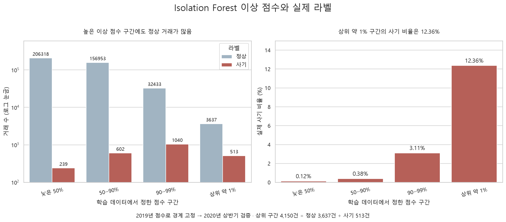
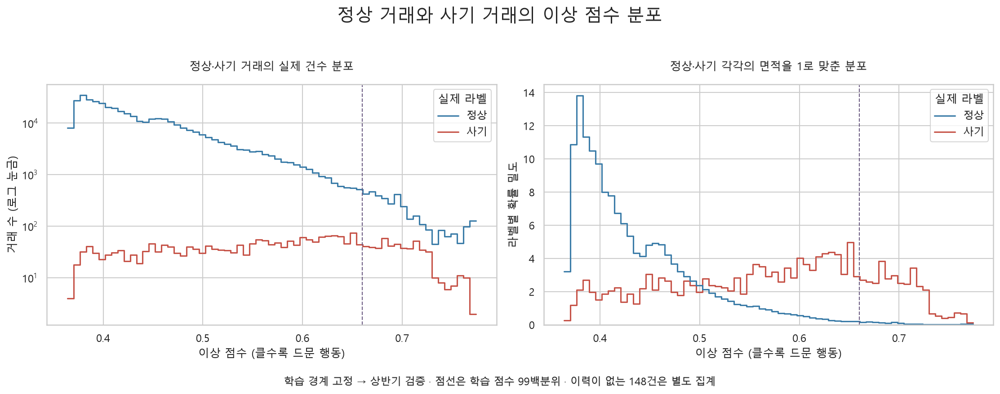

# 거래 직전 이력의 이상 점수

이슈 #8의 두 번째 단계로 Isolation Forest를 학습했습니다. 모델은 과거에 보기 드문 행동 상태가 어느 것인지 점수로 나타냅니다. 이 단계에서 군집과 이상 점수를 탐지 모델에 추가할 준비를 하고, 실제 사기 탐지의 개선폭은 후속 추가·제거 비교로 확인합니다.

## 입력과 학습

[기존 이력 계산](../docs/history_features.md)의 최근 1시간·7일 건수, 7일 평균 금액과 표준편차를 사용합니다. 2019년 이력이 있는 거래에 `log1p`를 적용하고 학습 구간에서 평균과 표준편차를 정해 크기를 맞춥니다. 이 입력으로 트리 100개, 트리당 표본 256개, 시드 42인 Isolation Forest를 학습합니다. [설정](../configs/behavior_anomalies.toml)

scikit-learn의 `score_samples`는 작은 값이 더 드문 행동을 뜻하므로, 부호를 바꿔 **큰 점수일수록 더 드물다**는 방향으로 사용합니다. 사기 라벨은 모델 학습에 넣지 않고 결과의 사기 건수를 집계할 때 사용합니다. [공식 API 설명](https://scikit-learn.org/stable/modules/generated/sklearn.ensemble.IsolationForest.html)

학습 점수의 50·90·99백분위에서 경계를 정하고, 검증 구간에는 이 경계를 그대로 적용합니다. 같은 점수는 같은 구간에 배정하므로 실제 구간 비율은 백분위와 조금 달라질 수 있습니다. 이력이 없는 거래는 `-1` 그룹으로 별도 집계하며 이상 점수를 부여할 이력 정보가 없는 상태로 취급합니다.

## 상반기 검증 결과

| 학습 점수로 정한 구간 | 점수 경계 | 검증 거래 | 사기 | 사기 비율 |
| --- | --- | ---: | ---: | ---: |
| 50백분위 미만 | 0.420602 미만 | 206,557 | 239 | 0.116% |
| 50~90백분위 | 0.420602 이상~0.533736 미만 | 157,555 | 602 | 0.382% |
| 90~99백분위 | 0.533736 이상~0.660106 미만 | 33,473 | 1,040 | 3.107% |
| 99백분위 이상 | 0.660106 이상 | 4,150 | 513 | 12.361% |
| 최근 이력 없음 | 점수 없음 | 148 | 25 | 16.892% |

경계는 소수점 여섯 자리로 표시했으며 실제 집계는 저장한 전체 정밀도 값을 사용했습니다. 학습에서 상위 약 1%에 해당하는 경계를 넘은 검증 거래 4,150건 중 정상 거래는 3,637건이었습니다. 따라서 드문 행동 점수만으로 사기를 확정할 수 없습니다.

이 높은 점수 구간에서는 직전 7일 건수의 중앙값이 5건, 평균 금액의 중앙값이 89.17이었습니다. 가장 낮은 점수 구간에서는 각각 22건과 56.72였습니다. 거래가 적어 평균·변동의 조합이 드문 경우도 높은 점수를 받을 수 있습니다. 현재 결제 금액 자체는 이 모델의 입력에 포함되지 않습니다.

학습 거래 924,850건·사기 5,220건, 검증 거래 401,883건·사기 2,419건이 구간별 합계와 일치했습니다. 저장한 모델을 다시 불러 점수가 유한한지, 더 드문 합성 이력의 점수가 더 큰지, 변환 중 학습 통계가 바뀌지 않는지 확인했습니다.





분포의 왼쪽은 개별 검증 거래 건수를 로그 눈금으로 나타냅니다. 오른쪽은 정상과 사기 각각의 면적을 1로 맞춰 점수가 어디에 집중되는지 비교합니다. 사기 비율을 나타내는 앞선 막대그래프와 읽는 방법이 다릅니다. 점선은 학습 점수의 99백분위입니다.

왼쪽 그래프는 건수 차이를 함께 볼 수 있게 로그 눈금을 사용합니다. 오른쪽은 각 구간 안의 사기 비율입니다. 이력이 없는 검증 거래 148건은 이 그래프에서 제외했습니다.

두 보고서의 그래프는 다음 명령으로 집계 JSON에서 다시 그릴 수 있습니다.

```sh
uv run --locked --group ml python tools/plot_behavior_analysis.py
uv run --locked --group ml python tools/plot_behavior_distributions.py
```

## 실행

```sh
uv run --locked --group ml python tools/score_behavior_anomalies.py
```

스크립트는 원본 해시를 확인하고 학습·검증 순서대로 기존 이력 함수를 실행합니다. `artifacts/behavior_anomalies/`에 스케일러와 Isolation Forest, 고정 점수 경계와 집계 결과를 저장합니다. 공개 보고서에는 개별 거래 식별자와 원본 행을 포함하지 않습니다.
