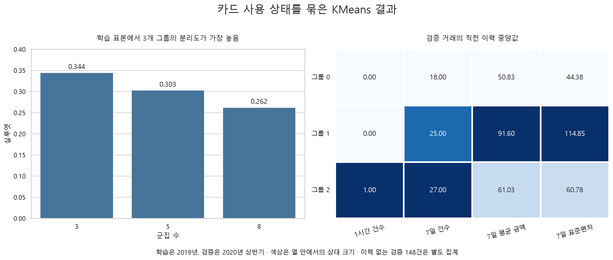

# 결제 직전 이력의 행동 군집

이슈 #8의 첫 단계로 KMeans 군집을 학습했습니다. 한 행은 카드 한 장의 영구적인 등급이 아니라 **거래가 들어오기 직전의 카드 사용 상태**입니다. 같은 카드라도 시점에 따라 다른 그룹에 속할 수 있습니다.

## 입력과 선택 방법

최근 1시간 건수, 최근 7일 건수, 최근 7일 평균 금액과 표준편차를 사용합니다. [#4의 이력 계산](../docs/history_features.md)을 재사용해 현재 거래를 추가하기 전에 값을 구했습니다. 2019년 이력으로 스케일러와 군집을 학습하고, 2020년 상반기 거래는 같은 스케일러로 변환해 기존 군집에 배정했습니다.

이력이 있는 행의 네 값에 `log1p`를 적용해 큰 값의 영향을 줄인 뒤, 학습 데이터의 평균과 표준편차로 크기를 맞췄습니다. 최근 7일 거래가 0건인 경우는 `-1` 그룹으로 따로 집계합니다. 이 그룹의 평균·표준편차 집계값 `-1`은 이력 없음 표시입니다.

3·5·8개 군집을 시드 42와 초기화 10회로 학습했습니다. 학습 데이터에서 시드로 고정해 뽑은 3,000행에 실루엣 점수를 계산했습니다. 실루엣은 같은 그룹의 거래가 서로 가깝고 다른 그룹과는 떨어져 있을수록 높아지는 값입니다. 이 점수가 가장 높은 군집 수를 선택합니다. 사기 라벨은 선택 후 그룹 특성을 설명하는 집계에 사용합니다. [KMeans](https://scikit-learn.org/stable/modules/generated/sklearn.cluster.KMeans.html) · [실루엣 점수](https://scikit-learn.org/stable/modules/generated/sklearn.metrics.silhouette_score.html)

## 학습·검증 결과

학습 표본에서 3개 군집의 실루엣은 0.3444, 5개는 0.3027, 8개는 0.2623이어서 **3개 군집**을 선택했습니다.

| 검증 그룹 | 거래 수 | 직전 1시간 건수 중앙값 | 직전 7일 건수 중앙값 | 7일 평균 금액 중앙값 | 7일 표준편차 중앙값 | 사기 비율 |
| --- | ---: | ---: | ---: | ---: | ---: | ---: |
| 0 | 228,061 | 0 | 18 | 50.83 | 44.38 | 0.125% |
| 1 | 116,579 | 0 | 25 | 91.60 | 114.85 | 1.312% |
| 2 | 57,095 | 1 | 27 | 61.03 | 60.78 | 1.012% |
| 이력 없음 | 148 | 0 | 0 | 해당 없음 | 해당 없음 | 16.892% |

그룹 0은 1보다 평균 금액과 금액 변동이 작았습니다. 그룹 2는 최근 1시간에 이미 거래가 있었던 경우가 많았습니다. 세 군집은 동일 카드의 여러 시점을 포함하며, 고유 카드 수를 군집 간 합산하면 중복이 생깁니다. 검증에서 932개 카드 중 932개가 그룹 0, 927개가 그룹 1, 920개가 그룹 2에 한 번 이상 속했습니다.

이력 없음 148건은 신규 카드와 오랫동안 거래가 없던 카드의 거래를 모두 포함합니다. 해당 그룹의 사기 비율은 표본이 작고 합성 데이터의 생성 방식에 영향을 받습니다. 이 수치는 패턴을 이해하기 위한 집계이며, 실제로 군집 정보가 사기를 더 잘 찾게 하는지는 후속 비교에서 평가합니다.

학습 거래 합계 924,850건과 검증 거래 합계 401,883건이 각 그룹의 거래 합계와 일치했습니다. 기본 이력 계산·거래 처리 테스트 9개와 코드 검사를 통과했습니다.



## 다시 실행하기

```sh
uv run --locked --group ml python tools/cluster_behaviors.py
```

[실행 설정](../configs/behavior_clusters.toml)을 읽고 원본 CSV의 해시를 확인합니다. 결과 집계와 스케일러·군집 모델은 로컬 `artifacts/behavior_clusters/`에 저장합니다. 그룹 번호는 구분을 위한 이름입니다. XGBoost에 추가해 탐지 성능이 좋아지는지는 이후 #8의 추가·제거 실험에서 확인합니다.
